# Primeiros passos com o DRerio LogAI

Do programa recém-instalado até um relatório pronto, na ordem em que você vai fazer de verdade.

Versão em inglês: [Getting Started](GETTING_STARTED.md).

Este guia descreve a interface como ela é: cada item de menu, botão e passo abaixo existe e tem
exatamente o nome que o programa usa (as telas em inglês aparecem com os rótulos originais entre
parênteses quando isso ajuda a achar o botão).

## Conteúdo

- [Antes da primeira análise](#antes-da-primeira-análise)
- [A primeira abertura](#a-primeira-abertura)
- [Configurando os modelos de detecção](#configurando-os-modelos-de-detecção)
- [A janela principal](#a-janela-principal)
- [Que tipo de projeto criar](#que-tipo-de-projeto-criar)
- [Criando um projeto pré-gravado](#criando-um-projeto-pré-gravado-7-passos)
- [Desenhando a arena e as ROIs](#desenhando-a-arena-e-as-rois)
- [Usar um peso com outras classes](#usar-um-peso-com-outras-classes-papéis)
- [Definir início e fim da análise](#definir-início-e-fim-da-análise)
- [Processando os vídeos](#processando-os-vídeos)
- [Relatórios e resultados](#relatórios-e-resultados)
- [Projetos ao vivo](#projetos-ao-vivo)
- [Analisando um vídeo único, sem projeto](#analisando-um-vídeo-único-sem-projeto)
- [Teclado e mouse](#teclado-e-mouse)
- [Para onde ir depois](#para-onde-ir-depois)
- [Glossário](#glossário)

## Antes da primeira análise

Você precisa de:

- **O programa instalado** — veja [Instalação e configuração](../1_Instalacao.md).
- **Seus vídeos**, ou uma câmera conectada. MP4 é o formato mais seguro; AVI, MOV e MKV funcionam,
  e em geral tudo que o OpenCV abre.
- **As dimensões físicas do aquário, em centímetros** (largura e altura da área que a câmera vê).
  Sem elas, distâncias e velocidades só podem ser reportadas em pixels.
- **Uma decisão sobre o ângulo da câmera**: lateral (de lado, como no novel tank test) ou de cima
  (como num campo aberto). O modelo de detecção depende disso.

## A primeira abertura

1. **A pergunta de idioma.** A resposta é gravada em `config.local.yaml`. O idioma do sistema
   operacional não é consultado de propósito. Mude depois em **Configurações → Idioma...**.

2. **Uma tela de abertura com o teste de hardware.** Ela converte um modelo para OpenVINO e mede
   quão rápido cada dispositivo disponível o executa, para escolher o backend. Esta é a abertura
   mais lenta que você terá: o resultado fica em cache.

3. **A janela principal.**

   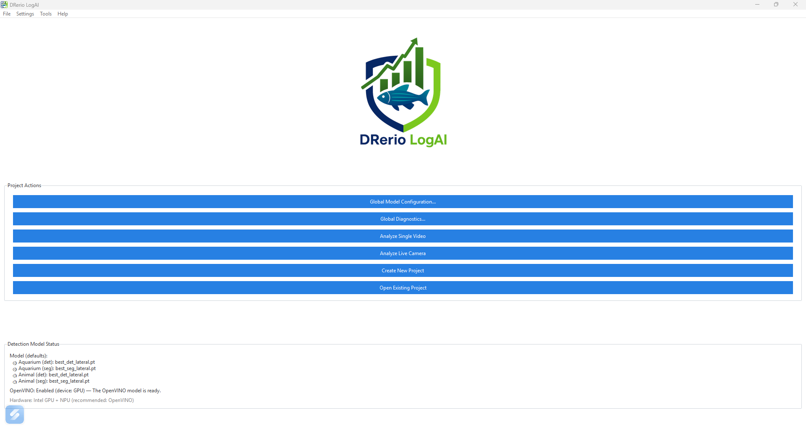

4. **A janela de Primeiros passos**, que explica os modelos e lê o seu hardware para dizer se vale
   ligar o OpenVINO aqui. O botão dela abre o painel de modelos; esse painel também está sempre em
   **Configurações → Definições de modelo...**, e esta janela em **Ajuda → Primeiros passos...**.

## Configurando os modelos de detecção

Faça isso uma vez, antes da primeira análise. **Configurações → Definições de modelo...**

### Quais são os seis modelos

O `fetch-weights` (executado pelo instalador) coloca seis modelos YOLO treinados em `weights/`:

| Modelo | Tipo | Ângulo da câmera |
| --- | --- | --- |
| `best_det_lateral.pt` | detecção — uma caixa em volta do animal | lateral (de lado) |
| `best_seg_lateral.pt` | segmentação — o contorno do animal | lateral |
| `best_det_topdown.pt` | detecção | de cima |
| `best_seg_topdown.pt` | segmentação | de cima |
| `best_oi.pt` | detecção | qualquer (generalista, menos preciso) |
| `best_seg.pt` | segmentação | qualquer (generalista, menos preciso) |

**Um modelo treinado para um ângulo não acha nada no outro.** Um modelo lateral observando uma
gravação feita de cima não reporta peixe nenhum, mesmo com o peixe bem visível. Combinar o modelo
com a sua câmera é a configuração mais importante desta tela.

### Os quatro papéis

Em **Pesos padrão por papel**, um modelo é atribuído a cada papel:

- 🐠 **Aquário (Detecção)** — acha o tanque como um retângulo
- 🐠 **Aquário (Segmentação)** — acha a forma real do tanque
- 🐟 **Animal (Detecção)** — acha cada peixe como uma caixa
- 🐟 **Animal (Segmentação)** — acha cada peixe como uma máscara

Os quatro especialistas já vêm atribuídos. Escolha o par que corresponde ao seu ângulo de câmera;
os generalistas existem para montagens que os especialistas não atendem, e são escolha explícita.

**Detecção ou segmentação?** A detecção é mais leve e basta quando a posição aproximada resolve. A
segmentação é melhor quando a precisão espacial importa — regiões pequenas, bordas, vários animais
próximos — e é **obrigatória** se você pretende usar a regra de ROI `seg_overlap`, que compara a
máscara do animal com a região.

### OpenVINO

| Sua máquina | O que fazer |
| --- | --- |
| Tem placa de vídeo NVIDIA | Deixe o OpenVINO desligado — PyTorch com CUDA costuma ser mais rápido |
| CPU Intel / vídeo integrado / NPU, sem NVIDIA | Ligue: é o que torna o rastreamento rápido aqui |
| Nenhum dos dois | Deixe desligado; a análise roda na CPU, mais devagar |

Marque **Otimizar com OpenVINO (para hardware Intel)**, escolha o **dispositivo OpenVINO**,
selecione os pesos que pretende usar e clique em **Converter para OpenVINO**. A conversão acontece
uma vez por peso e fica em cache; o catálogo mostra ✓ Pronto, ⏳ Convertendo ou ✗ Falhou.

O mesmo painel oferece **Adicionar peso...** (registrar um modelo treinado por você), **Validar
caminhos**, **Reescanear a pasta de pesos**, manutenção do cache OpenVINO e **Refazer o benchmark de
hardware**.

## A janela principal

Antes de abrir qualquer projeto, a tela inicial oferece:

| Botão | O que faz |
| --- | --- |
| **Criar Novo Projeto** | Abre o assistente de projeto |
| **Abrir Projeto Existente** | Reabre uma pasta de projeto criada antes |
| **Analisar Vídeo Único** | Um vídeo, sem projeto, sem desenho experimental |
| **Analisar Câmera ao Vivo** | Uma sessão ao vivo avulsa, sem projeto |
| **Configuração Global de Modelos...** | O mesmo painel de **Configurações → Definições de modelo...** |
| **Diagnóstico Global...** | Roda os modelos ativos contra um quadro de exemplo e informa o que encontraram |

O painel **Status do Modelo de Detecção**, logo abaixo, informa os pesos ativos por papel, o estado
do OpenVINO e o hardware detectado — vale uma olhada antes de começar um lote longo.

## Que tipo de projeto criar

| Você tem | Use |
| --- | --- |
| Vídeos já gravados, organizados em pastas por grupo/dia/sujeito | **Criar Novo Projeto** → experimental (pré-gravado) |
| Uma câmera, e experimentos ainda por fazer | **Criar Novo Projeto** → ao vivo |
| Um vídeo, para olhar rapidamente | **Analisar Vídeo Único** |
| Uma câmera, para um teste rápido sem estrutura | **Analisar Câmera ao Vivo** |

O projeto é o que dá a estrutura grupo/dia/sujeito, o acompanhamento de status por vídeo e o
relatório unificado do experimento inteiro. Os dois modos avulsos dispensam tudo isso.

## Criando um projeto pré-gravado (7 passos)

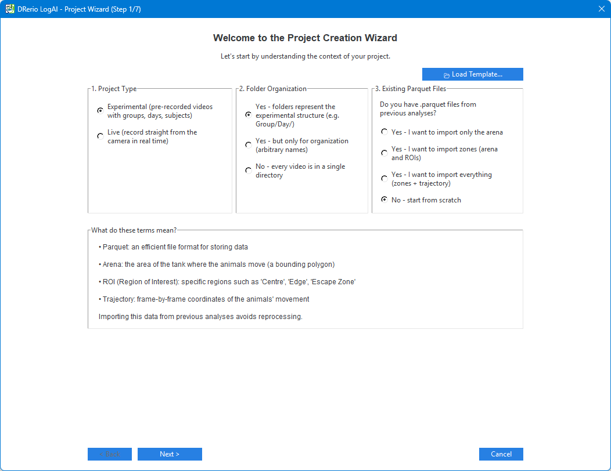

### Passo 1 — Descoberta

- **Tipo de projeto**: *Experimental (vídeos pré-gravados com grupos, dias, sujeitos)*.
- **Organização das pastas**: se as suas pastas significam algo (ex.: `Grupo_CBD/Dia_1/...`), se
  servem só para organizar, ou se não existem (tudo numa pasta só).
- **Arquivos Parquet existentes**: o que fazer com arquivos de análise que já estejam ao lado dos
  vídeos — importar a arena, importar as zonas, importar tudo, ou começar do zero.

  > **Recusar aqui é respeitado.** Um projeto criado sobre uma pasta com arena e ROIs de um estudo
  > anterior chegou a adotá-las em silêncio no primeiro duplo clique, e o relatório saía completo,
  > medido contra a arena errada.

**📂 Carregar modelo...** restaura as respostas de um assistente que você salvou antes.

### Passo 2 — Seleção de vídeos

**📁 Adicionar arquivos...** para vídeos individuais, **📂 Adicionar pasta...** para uma árvore
inteira. A **prévia da estrutura** mostra como a seleção foi entendida; os vídeos dentro das pastas
são enumerados no passo seguinte ao próximo.

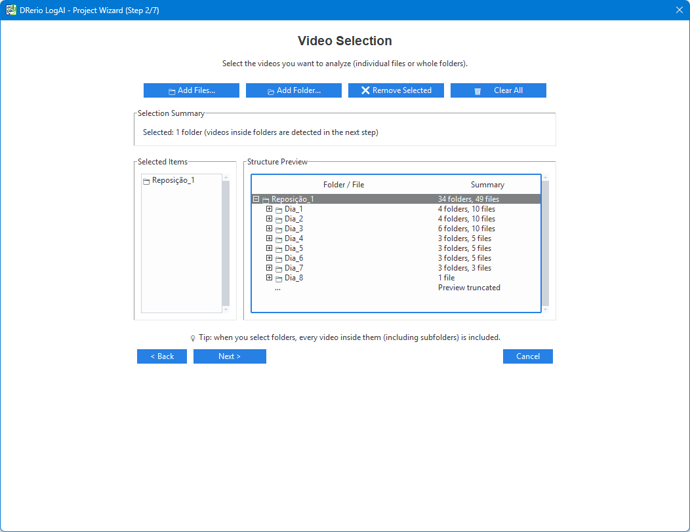

### Passo 3 — Calibração física

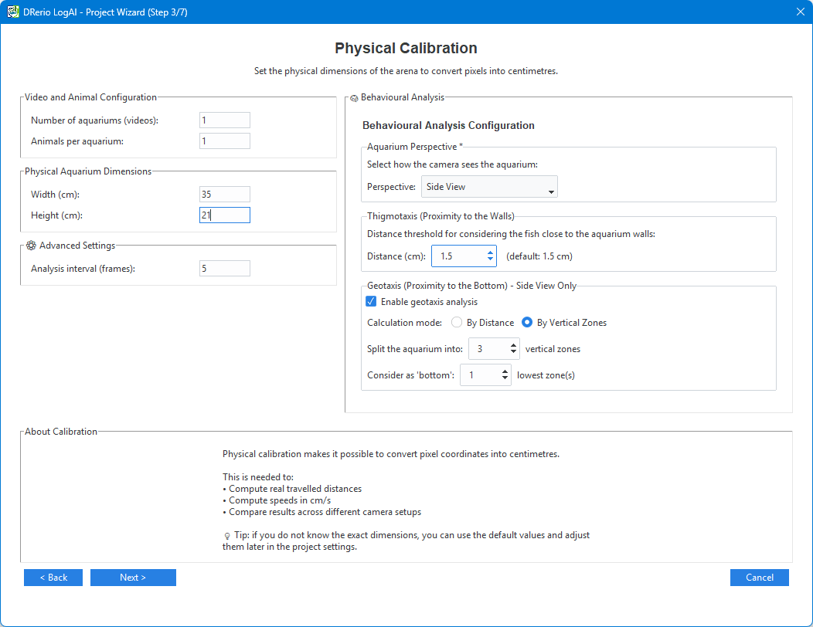

- **Largura (cm)** e **Altura (cm)** do aquário: é isso que converte pixels em centímetros, então
  toda distância, velocidade e métrica em cm depende daqui. Meça a área que a câmera realmente vê.
- **Número de aquários (vídeos)**: mais de um quando vários tanques são filmados lado a lado no
  mesmo vídeo.
- **Animais por aquário**.
- **Intervalo de análise (quadros)**: analisa um quadro a cada N (10 por padrão). Menor significa
  mais detalhe temporal e mais tempo de processamento.
- **🧠 Análise comportamental**: opções de tigmotaxia e geotaxia.

### Passo 4 — Detecção automática do desenho

A estrutura de pastas e os nomes dos arquivos viram **Grupos**, **Dias** e **Sujeitos**, com um
valor de confiança e um resumo do que foi encontrado.

- **🔄 Reanalisar** depois de mudar algo.
- **✏️ Editar desenho** para corrigir à mão.
- **🔧 Regex personalizada** quando sua nomenclatura exige um padrão explícito.

Confirme os nomes dos grupos antes de seguir: tudo daí para frente — pastas, relatórios,
comparações — é construído a partir deles.

### Passo 5 — Modelos e Pesos

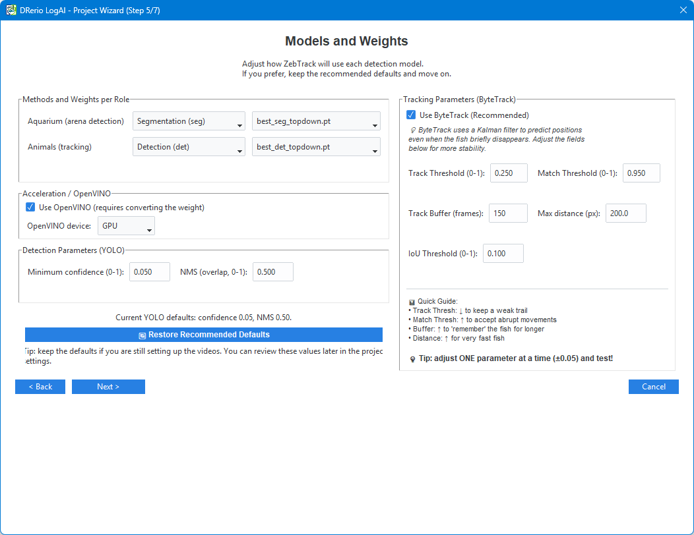

Método (segmentação ou detecção) e peso, separadamente para **Aquário (detecção da arena)** e
**Animais (rastreamento)**; a chave do OpenVINO e o dispositivo; e os parâmetros do detector:

| Parâmetro | Padrão | O que faz |
| --- | --- | --- |
| Confiança mínima (0–1) | 0,05 | O quanto o modelo precisa estar certo para aceitar uma detecção |
| NMS (sobreposição, 0–1) | 0,5 | O quanto duas detecções podem se sobrepor antes de uma ser descartada |
| Track Threshold (0–1) | 0,25 | Confiança mínima para uma detecção manter uma trilha viva |
| Match Threshold (0–1) | 0,95 | O quanto a associação entre quadros é permissiva (maior = mais permissivo) |
| Track Buffer (quadros) | 150 | Por quanto tempo um animal perdido mantém a identidade |
| Distância máxima (px) | 400 | O quanto um animal pode se deslocar entre quadros analisados e ainda ser o mesmo |
| IoU Threshold (0–1) | 0,05 | Abaixo dessa sobreposição, o pareamento recorre à distância entre centros |

> **Ajuste um parâmetro de cada vez, em torno de ±0,05, e teste.** Mexer em dois ao mesmo tempo
> torna o resultado impossível de atribuir. **🔄 Restaurar padrões recomendados** desfaz o
> experimento.

### Passo 6 — Configuração de importação

Por vídeo, o que importar dos arquivos encontrados ao lado dele: **Arena**, **ROIs**,
**Trajetória**. Quando já existem ROIs, escolha a estratégia: **Substituir**, **Mesclar (manter as
duas)** ou **Manual (perguntar)**.

### Passo 7 — Confirmação

Nome e local do projeto, o resumo de todas as respostas, e **💾 Salvar como modelo** para reaproveitar
a configuração no próximo estudo. **Finalizar** cria o projeto.

## Desenhando a arena e as ROIs

Na aba **Configuração de Zonas**, trabalhando sobre um quadro real da sua gravação.

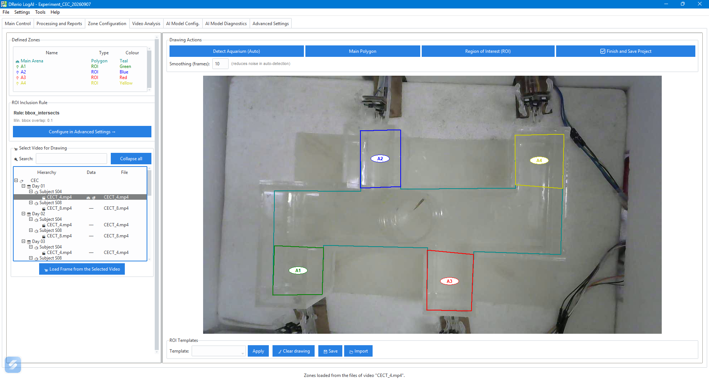

1. **📹 Selecionar vídeo para desenho** e depois **📹 Carregar quadro do vídeo selecionado**.
2. **A arena** — use **Detectar Aquário (Auto)**, que propõe um polígono (a **Suavização (quadros)**
   reduz o ruído dessa detecção), ou **Polígono Principal** para desenhar você mesmo. Clique nos
   vértices, depois **✓ Fechar polígono** e **💾 Salvar esta área**.
3. **As regiões de interesse** — **Região de Interesse (ROI)**, um polígono por região. Dê nome a
   cada uma: as métricas saem por ROI com esses nomes.
4. **Modelos** — **💾 Salvar** guarda o conjunto atual de regiões; **📂 Importar** aplica um
   conjunto salvo a outro vídeo ou projeto.
5. **✅ Finalizar e Salvar Projeto**.

Errar é barato: **↶ Desfazer (Ctrl+Z)** e **↷ Refazer (Ctrl+Y)**, e **❌ Descartar** abandona o
polígono em desenho.

**A regra de inclusão** decide o que conta como o animal estar dentro de uma região:

| Regra | Dentro quando |
| --- | --- |
| `bbox_intersects` (padrão) | A caixa em volta do animal sobrepõe a região |
| `centroid_in` | O centro do animal está dentro da região |
| `centroid_in_on_buffered_roi` | O mesmo, numa região expandida ou contraída por uma margem |
| `seg_overlap` | A máscara do animal sobrepõe a região acima de uma fração (0,3 por padrão) |

A `seg_overlap` precisa de máscaras, que só existem se tiverem sido gravadas — método de
segmentação, persistência de máscaras ligada e essa regra em vigor. Quando faltam, a análise recorre
a `bbox_intersects` e avisa no relatório, em vez de falhar.

Com vários aquários num vídeo, o **Modo de processamento** escolhe entre **Simultâneo (1 passada,
mais rápido)** e **Sequencial (2 passadas, 1 aquário por vez)**, e **🐟 Aquário ativo** seleciona
qual deles você está desenhando.

As zonas pertencem ao vídeo em que foram desenhadas. Um vídeo sem zonas próprias usa o padrão do
projeto.

## Usar um peso com outras classes (papéis)

Desde a v8 qualquer peso de detecção YOLOv8/v11 funciona, não só os de zebrafish. O que o programa
precisa saber é o que cada classe do peso **é**:

| Papel | Significado |
| --- | --- |
| **Sujeito** | O animal que é rastreado e medido. Várias classes podem ser sujeito. |
| **Arena** | O aparato — aquário, caixa, labirinto. No máximo uma classe. |
| **Contexto** | Visto e registrado em todo frame, nunca rastreado: o experimentador, uma caixa de partida, uma tampa. Serve para iniciar ou encerrar a análise. |
| **Ignorada** | Descartada. |

Na maior parte das vezes você não faz nada: classes com nomes como `fish`, `zebrafish`, `rat`,
`mouse`, `animal` ou `subject` viram o sujeito, e `arena`, `tank`, `aquarium` ou `maze` viram a
arena. O resto fica ignorado até você dizer o contrário. Um peso com três ou mais classes nomeadas e
**nenhuma** reconhecível como o animal é recusado com uma mensagem — do contrário ele rastrearia a
classe que viesse primeiro.

Onde definir os papéis:

- **Para o peso** — *Configuração Global de Modelos…* → catálogo de pesos → selecione o peso →
  **Papéis das classes…**. Todo projeto que usar esse peso recebe esses papéis.
- **Para um projeto** — aba **Config. Modelo IA**, *Papéis das classes do peso do projeto*. Os
  papéis ficam presos àquele arquivo de peso exato: se você trocar ou retreinar o peso, o painel avisa
  que eles estão sendo ignorados.
- **Ao criar o projeto** — a seção opcional **Papéis das classes** do passo 5 (Modelos e Pesos).

Em qualquer um deles, escolha um papel por classe na tabela e clique em **Salvar**; **Restaurar
automático** volta aos papéis pelo nome. O painel recusa um mapa sem sujeito ou com duas arenas.

**Exemplo — o peso do labirinto de Barnes.** Ele tem quatro classes: `arena`, `experimenter`,
`rat` e `start_box`. Os papéis automáticos já fazem de `rat` o sujeito e de `arena` a arena; marque
`experimenter` e `start_box` como **Contexto** para que a janela de análise possa vê-los. Com um
mapa explícito, o canvas de zonas e o quadro de análise desenham cada papel com a sua cor, as caixas
de contexto em laranja com o nome da classe.

As detecções de contexto, e uma linha de "batimento" por frame processado, são gravadas ao lado da
trajetória em `3c_Objetos_<vídeo>.parquet`.

## Definir início e fim da análise

Por padrão a análise cobre a gravação inteira, a partir do primeiro frame em que o animal aparece.
Quando o protocolo diz que a medida começa depois — quando o experimentador sai, quando uma porta
abre, quando o Arduino manda um código — defina uma **janela de análise**.

Na aba **Configuração de Zonas**, o painel **Janela de Análise (Opcional)** mostra a regra atual em
palavras. **Editar condições…** abre o editor, com um bloco **Início** e um bloco **Fim**. Cada bloco
é uma lista de linhas:

| Linha | Dispara quando |
| --- | --- |
| Classe presente / ausente | uma classe (ou qualquer classe de um papel) está ou não visível |
| …mantida por (segundos ou frames) | as linhas de classe acima ficaram verdadeiras por esse tempo |
| Sujeito entra / sai da ROI | o animal entra ou sai de uma das ROIs do projeto |
| Tempo do vídeo atinge / Número do frame atinge | um instante fixo do vídeo |
| Tempo após o início | tantos segundos depois do Início (só no Fim) |
| Sinal do Arduino | o Arduino envia um código (em branco = qualquer código) |
| Sinal manual | você clica em **Marcar início/fim** numa sessão ao vivo |
| Fim do vídeo | a gravação termina (só no Fim) |

**Combinar as linhas** com *todas*, *qualquer uma (vale a primeira)* ou *em sequência*. Mais duas
escolhas completam a regra: **Se o Início nunca acontecer** (usar a gravação inteira, com aviso, ou
deixar as métricas vazias) e, em sessões ao vivo, **Quando o Fim acontecer** (só marcar o fim, ou
encerrar a sessão ao vivo). **Salvar** grava a regra no projeto; ela vale na próxima vez que você
rodar a análise — nada precisa ser detectado de novo.

**Exemplo — o labirinto de Barnes.** **Predefinição: labirinto de Barnes** preenche o protocolo:
Início quando a caixa de partida e o experimentador estão ausentes e o rato está presente, mantido
por 5 frames; Fim no primeiro entre o fim do vídeo, o rato ausente por 3 s ou 240 s após o Início.
Se o peso não tiver classe com algum desses nomes, o editor avisa; revise as linhas e clique em
**Salvar**.

O que a janela muda nos resultados:

- O vídeo é sempre gravado por inteiro; só as métricas ficam restritas a [Início, Fim].
- As condições são medidas no relógio da própria gravação (os carimbos de tempo do vídeo, ou o
  instante de captura numa sessão ao vivo), e um evento mantido por algum tempo é datado no seu
  **primeiro** frame.
- Taxas e percentuais dividem pela duração da janela. A latência de ROI conta a partir do Início; um
  animal que já está dentro no Início tem latência 0, marcada *presente no início*; um que nunca
  entra recebe a duração da janela, marcada *censurada* — um teto, não uma medida.
- O relatório Word ganha uma seção **Janela de Análise**, o `.xlsx` ganha as colunas `window_*` e
  as marcas de latência por ROI, e `7_AnalysisWindow_<vídeo>.json` registra o início e o fim ao lado
  da trajetória.

## Processando os vídeos

Em **Controle Principal**:

- **Analisar Vídeo(s) Selecionado(s)** — os selecionados na árvore.
- **Processar Vídeos Pendentes...** — tudo que ainda não foi processado.
- **Adicionar Vídeos/Pastas ao Projeto...** — para ampliar o projeto depois.

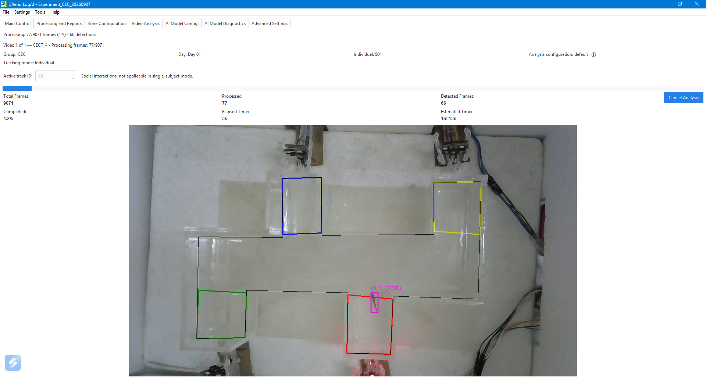

A aba **Análise de Vídeo** acompanha a execução: quadros processados, detecções, tempo decorrido e
estimado, e a sobreposição com o ID de trilha e a confiança de cada animal. É lá também que se
escolhe quais `track_id` manter — todos, ou um específico.

A árvore do projeto mostra o estado de cada vídeo, por grupo, dia e sujeito:

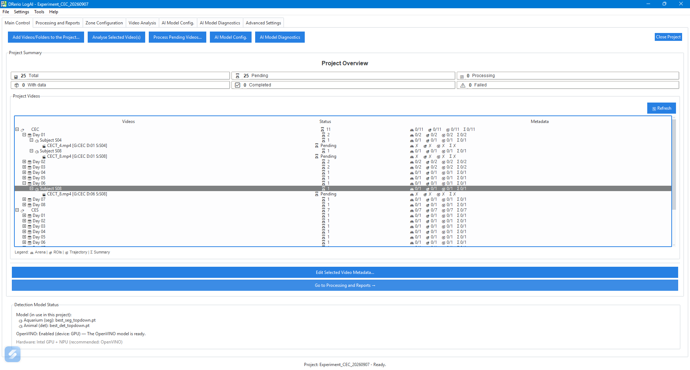

**Quanto tempo leva, mais ou menos:** num notebook Intel típico, com OpenVINO ligado e o intervalo
de análise padrão de 10, um vídeo de 5 minutos em 1080p leva alguns minutos. Baixar o intervalo para
1 multiplica isso por cerca de dez.

## Relatórios e resultados

A aba **Processamento e Relatórios** gera:

- **🧾 Relatórios parciais** — por vídeo: trajetória, sumário e relatório Word.
- **Relatórios unificados** — uma comparação de todo o projeto, em `<projeto>/unified_reports/`, com
  uma planilha de dados mais estatísticas descritivas, um CSV, um Word com boxplots comparativos e
  um manifesto JSON da execução.

Duplo clique em qualquer item abre o arquivo.

### Os arquivos gerados, por vídeo

```text
<pasta de resultados>/
├── 1_ProcessingArea_<vídeo>.parquet # Arena (área de processamento)
├── 2_AreasOfInterest_<vídeo>.parquet # ROIs
├── 3_CoordMovimento_<vídeo>.parquet # Trajetória quadro a quadro
├── 3b_Mascaras_<vídeo>.parquet      # Máscaras de segmentação (só quando gravadas)
├── 3c_Objetos_<vídeo>.parquet       # Objetos detectados por frame (v8)
├── 7_AnalysisWindow_<vídeo>.json    # Início e fim da janela de análise (v8, só com janela)
├── 4_Relatorio_<vídeo>.xlsx         # Métricas por ROI, mais uma aba por animal
└── 4_Relatorio_<vídeo>.docx         # Relatório ilustrado
```

Com vários aquários num vídeo, cada um ganha uma subpasta `aquarium_1/`, `aquarium_2/`, … com os
mesmos arquivos. Um vídeo único analisado sem projeto grava `<vídeo>_summary.xlsx` e
`<vídeo>_report.docx` no lugar do par `4_Relatorio_`.

O esquema da trajetória é fixo e não muda entre versões:

```text
timestamp, frame, track_id, x1, y1, x2, y2, confidence
[x_center_px, y_center_px, x_cm, y_cm]*   — quando há calibração
```

- `track_id` — a identidade do animal ao longo dos quadros
- `x1, y1, x2, y2` — a caixa delimitadora, em **pixels brutos do vídeo**
- `confidence` — o quanto o detector estava certo, de 0 a 1

> O `timestamp` é um **relógio de processamento**, não o instante de captura. Em sessões ao vivo, o
> tempo real está em `6_FrameLedger_<base>`.

Lendo em Python:

```python
import pandas as pd

df = pd.read_parquet("meu_video_results/3_CoordMovimento_meu_video.parquet")
um_animal = df[df["track_id"] == 1]
```

### Gráficos

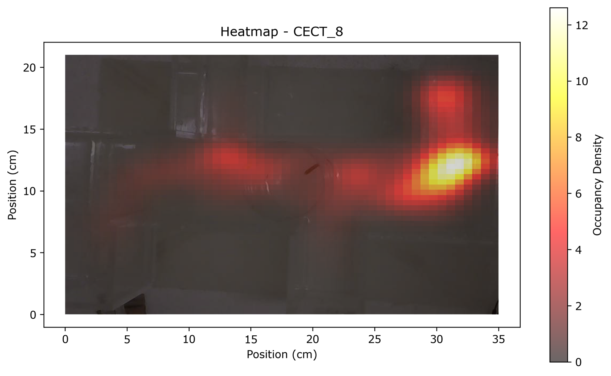

O mapa de calor mostra onde o animal passou o tempo — mais quente, mais tempo. O gráfico de
trajetória mostra o próprio percurso, com as regiões definidas pelo operador sobre a arena:

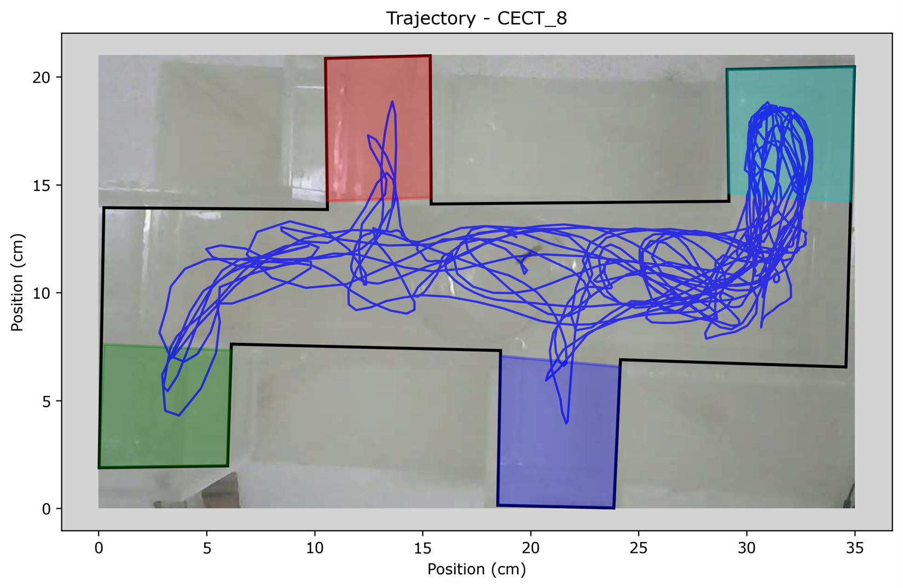

Os dois são gerados automaticamente e embutidos no relatório Word.

### As métricas

Locomoção (distância total, velocidade média/máxima/desvio, tortuosidade), velocidade angular e
viradas bruscas, episódios comportamentais (surtos de velocidade, inatividade), tigmotaxia, geotaxia
e, por ROI: tempo, entradas, saídas, latência até a primeira entrada, distância e velocidade dentro
da região.

Cada nome de coluna e fórmula: [`docs/reference/metrics.md`](../../reference/metrics.md).

> **Gravações de durações diferentes não podem ser comparadas em métricas absolutas** (distância
> total, número de entradas, tempo em ROI). O programa avisa antes de gerar o relatório e carimba a
> ressalva no `.docx`; normalize usando a coluna `video_duration_s` do `.xlsx`.

## Projetos ao vivo

Um projeto ao vivo grava e analisa ao mesmo tempo, seguindo um desenho experimental.

### Criando (6 passos)

1. **Descoberta** — tipo de projeto: ao vivo.
2. **Desenho experimental** — duração em dias, número de grupos e seus nomes, animais por grupo. O
   assistente mostra quantas gravações isso dá.

   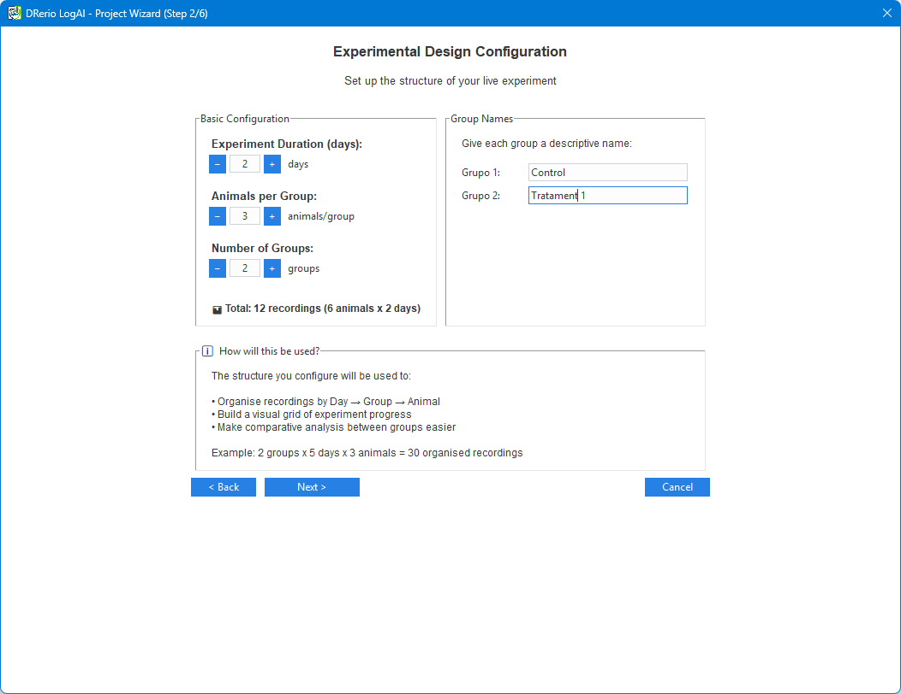

3. **Configuração da gravação ao vivo**:

   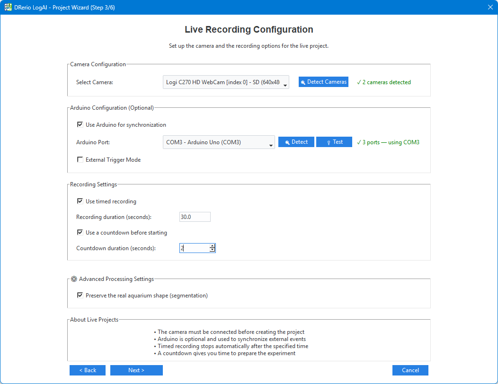

   - **🔍 Detectar câmeras** e então **Selecionar câmera**.
   - Opcional: **Usar Arduino para sincronização**; **🔍 Detectar** a porta e **🔌 Testar** a
     conexão.
   - **Modo de gatilho externo** — o Arduino inicia a gravação em vez do operador. É opcional e
     exige um sketch que envie `1`/`0` pela serial; o sketch de referência deste repositório **não**
     faz isso. Veja [`docs/guides/user/external-trigger.md`](../../guides/user/external-trigger.md).
   - **Usar gravação temporizada**, com duração em segundos (300 = 5 minutos) e, se quiser, uma
     contagem regressiva antes de começar.
4. **Calibração física**, 5. **Modelos e Pesos**, 6. **Confirmação** — como no fluxo pré-gravado.

### Rodando as sessões

O painel de sessões mostra um cartão por animal do dia e grupo atuais:

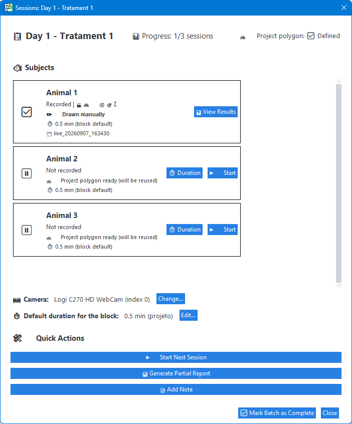

Clique em **▶️ Iniciar Gravação** para uma cobaia; **✖ Cancelar sessão** descarta uma gravação em
curso, inclusive a pasta dela — uma sessão cancelada não fica pela metade. Cada sessão cai em
`live_analysis_sessions/{experiment_id}_{timestamp}/`.

A **duração da gravação** pode ser definida por cobaia, por bloco (dia × grupo) ou para o projeto,
nessa ordem de precedência.

> Durações heterogêneas dentro de um bloco invalidam comparações de métricas absolutas. O programa
> avisa em vez de normalizar sozinho: a decisão é do pesquisador.

A aba **Progresso do Experimento** mostra a grade dia × grupo, com as sessões concluídas por célula:

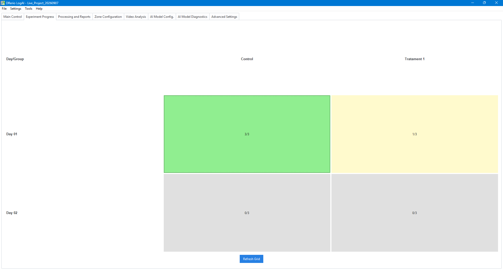

**Notas experimentais.** Clique numa célula para abrir o bloco: **📝 Adicionar Nota** anota o bloco
inteiro, e o botão **📝 Nota** de cada linha anota uma cobaia ("pulou do aquário no minuto 3"). As
notas ficam gravadas no projeto, a célula da grade ganha um 📝, e elas saem na seção *Notas
experimentais* do Word e na aba `Notas` do Excel dos relatórios parcial e de lote, e também no
relatório unificado (seção *Experiment Notes* e aba `Notes`). A nota de uma cobaia cuja sessão
falhou também aparece, marcada como fora do relatório, porque é ela que explica a ausência.

### Arduino, comandos por zona

Com um Arduino conectado, cada ROI pode enviar um inteiro quando um animal entra ou sai, e o
firmware decide o que aquele número faz:

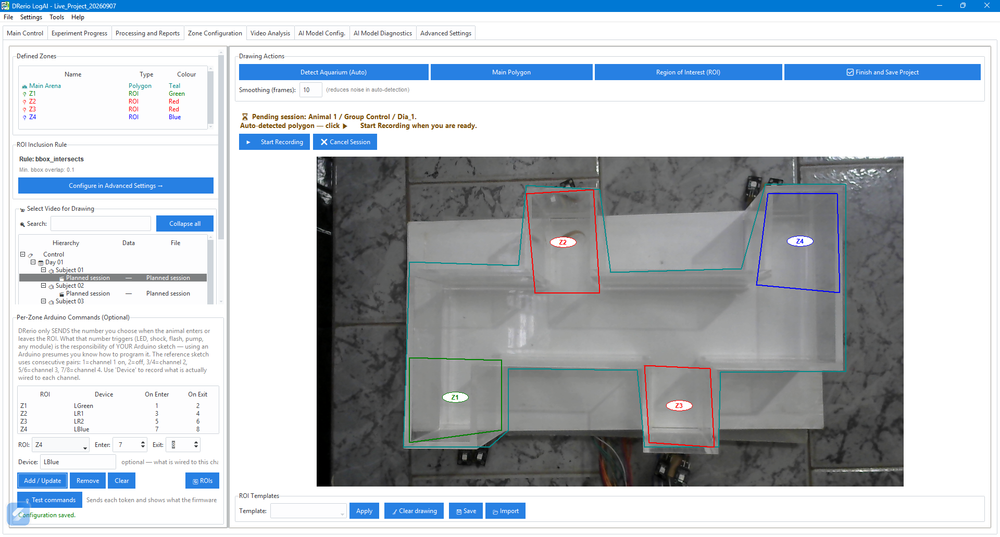

- **Cada token precisa ter um papel só.** Reaproveitar um inteiro como entrada de uma região e saída
  de outra deixa um dispositivo preso ligado e quebra a varredura de fim de sessão. O programa
  detecta o conflito e avisa, mas nunca reescreve seus comandos — só o sketch sabe o que cada número
  significa.
- **Confira contra a resposta do firmware, não contra a sua intenção.** O botão **🔌 Testar
  comandos** mostra o que a placa responde; um token de entrada respondido com "… OFF" prova que a
  ligação está invertida.
- Guia completo: [`docs/guides/user/arduino-bindings.md`](../../guides/user/arduino-bindings.md).

## Analisando um vídeo único, sem projeto

**Analisar Vídeo Único**, na janela principal: escolha o arquivo, defina a calibração e o número de
animais, desenhe a arena e as ROIs, e processe. As saídas são a mesma pasta `<video>_results/`; o
que você não tem é a estrutura grupo/dia/sujeito nem o relatório unificado.

**Analisar Câmera ao Vivo** faz o mesmo para uma sessão de câmera avulsa.

## Teclado e mouse

| Atalho | Ação |
| --- | --- |
| `Ctrl+Q` | Fechar o programa |
| `Ctrl+Z` / `Ctrl+Y` | Desfazer / refazer durante o desenho de zonas |
| Duplo clique (árvore de relatórios) | Abrir o relatório ou arquivo |
| Botão direito (árvore do projeto) | Menu de contexto: editar desenho, apagar dados específicos, remover um vídeo |

O menu de contexto da árvore do projeto é onde se apagam dados por vídeo de forma seletiva —
**🏛️ Apagar arena**, **📍 Apagar ROIs**, **📈 Apagar trajetória**, **📝 Apagar relatórios** — ou tudo
de uma vez, com **🧹 Apagar todos os dados de processamento**.

## Para onde ir depois

- [Tutorial completo](../2_Full_Tutorial.md) — o mesmo caminho com mais detalhe por tela.
- [FAQ](../3_FAQ.md) — as dúvidas mais frequentes.
- [Solução de problemas](TROUBLESHOOTING.md) — quando algo não funciona.
- [Referência de métricas](../../reference/metrics.md) — cada coluna e fórmula.
- [Configuração de rastreamento](../6_Configuracao_Rastreamento.md) — ajuste fino de detecção e
  rastreamento.
- Bugs e pedidos: [GitHub Issues](https://github.com/MarkSant/DRerio-LogAI/issues) ·
  Dúvidas: [Discussions](https://github.com/MarkSant/DRerio-LogAI/discussions)

## Glossário

**Arena** — o espaço físico em que os animais são rastreados, normalmente o aquário.

**ROI (região de interesse)** — uma região desenhada dentro da arena, cujas métricas são reportadas
separadamente (fundo, topo, um canto, uma câmara).

**Track ID** — a identidade que o rastreador atribui a um animal e carrega entre os quadros.

**Confiança** — o quanto o modelo está certo sobre uma detecção, de 0 a 1.

**Calibração** — a conversão de pixels para centímetros, a partir das dimensões reais do aquário.

**Detecção (det) / Segmentação (seg)** — uma caixa em volta do animal, ou o contorno dele.

**Parquet** — o formato de tabela compacto em que as trajetórias são gravadas; o `pandas` lê direto.

**Tigmotaxia** — a tendência a ficar perto das paredes, medida comum de comportamento tipo-ansiedade.

**Geotaxia** — preferência vertical (fundo, meio, superfície), medida na visão lateral.

**OpenVINO** — o acelerador da Intel, que faz os modelos rodarem mais rápido em hardware Intel.
